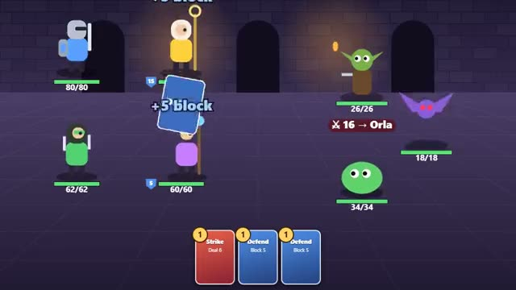

# Deck Dungeon

Build your deck. Guard your friends. Beat the king. A multiplayer starter game from [Multiplayer Agent](https://multiplayeragent.com): 2D, co-op, 1–4 players, with bots that play every hero nobody has.

## How it plays

Climb a branching dungeon of fights, shops and campfires. Every turn everyone plans their cards at once (attacks, blocks, heals for allies), then it all plays out; win a fight and pick a new card for your deck.

Each hero (Knight, Cleric, Rogue, Mage) has its own deck and its own reward cards. The monsters show what they will do next and to whom, so you can shield the friend who is about to get hit. The Hollow King waits at the top.

**Controls:** Click or tap cards to play them, then who to use them on, then End turn; tap a room on the map to vote. Keys 1–5 pick cards, Enter ends the turn.

## Make it yours in the Game Builder

Open the [Game Builder](https://multiplayeragent.com), choose **Start from a starter game** and pick Deck Dungeon. It opens as version 1 in your studio, ready to play and publish. Then ask for changes, for example:

- Make it a space station with robots instead of monsters
- Add a card that gives an ally an extra energy
- Add a treasure room that gives everyone a rare card

## Run it yourself

1. Get a free publishable key (`pk_…`) at [multiplayeragent.com](https://multiplayeragent.com).
2. In `index.html`, put it in place of `pk_REPLACE_ME` in the `MP_CONNECT` block.
3. Open `index.html` in a browser. No build step and no server needed.

Without a key it still runs, offline against bots.

## How it is built

- One `index.html`. The comment at the top of the script maps the code and explains the multiplayer.
- **Leaderboard:** The deepest floor each player's party reached.
- **Bots:** Bots play every hero nobody has, and play for you if your timer runs out.
- **Host-run rules:** The host's browser deals the cards, runs the monsters and resolves each turn; if it leaves, the next player takes over.
- **Live sync:** Everyone sees each other's planned cards, so you can work together.
- `?attract` runs it offline with bots only. The preview video is recorded from it.

## License

MIT.
